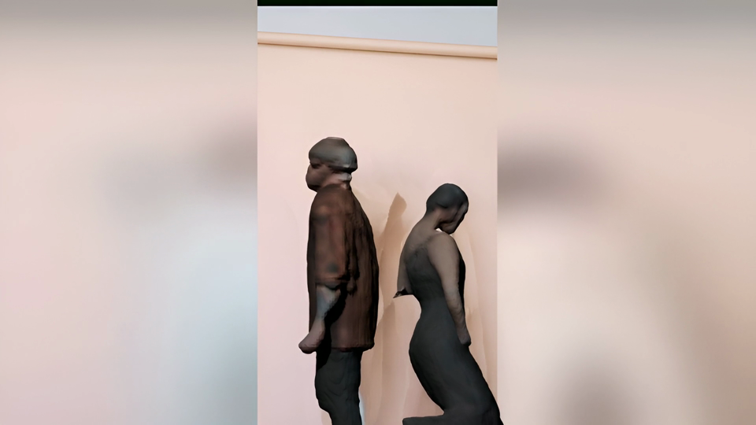

# Artefatos do teste de 30 s (20/11/2026)

- `teste-30s/output.mp4`: resultado final, 1920x1080 (9,7 MB)
- `teste-30s/antes_depois.mp4`: original à esquerda, resultado à direita (360p)
- `teste-30s/orig_3s.png` e `teste-30s/frame_3s.png`: o mesmo instante, antes e depois

Job: 16 min do envio ao vídeo pronto, US$ 0,15 de GPU (A40 no RunPod).

| Antes | Depois |
|---|---|
|  |  |
